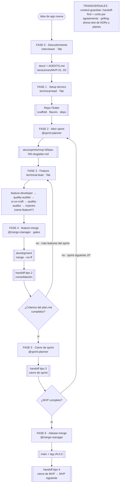

# WORKFLOW v2.2 — El Flujo Maestro de Desarrollo

> Cómo usar el equipo de agentes durante todo el ciclo de vida de un proyecto Flutter: **qué agente invocar, cuándo, con qué requisitos previos y qué decirle**. Desde la idea hasta la feature integrada y el release del MVP. Este documento es la fuente única del flujo de uso del equipo; los manuales detallados de cada rol siguen siendo `agents/*.md` y `skills/*/SKILL.md`.

## 0. Las tres preguntas clave

**1. Quiero empezar un proyecto nuevo, ¿qué agente uso y qué le digo?**
Habla con `interviewer` (se activa con `Tab`, es agente primario). Dile el rubro y la idea en una frase — él te entrevista en rondas, mapea tu árbol de decisiones y genera los `docs/` + `AGENTS.md` del proyecto. No necesita nada previo (si el proyecto pertenece a un portafolio con armazón, lo detecta solo leyendo `_shared/`).

**2. Ya tengo la documentación, ¿con quién hablo para empezar a codificar?**
Habla con `technical-lead` (se activa con `Tab`, es agente primario). El **primer** encargo es el setup técnico del repo (Fase 1). En paralelo abres el primer sprint con `@sprint-planner` (Fase 2). Solo entonces empieza el desarrollo de features (Fase 3) — también con `technical-lead`.

**3. Quiero desarrollar una feature, ¿qué debí hacer antes y a quién le asigno la tarea?**
Antes debiste completar: **(a)** docs del `interviewer`, **(b)** repo scaffold del `technical-lead` (Fase 1), **(c)** `plan.md` del sprint abierto por `@sprint-planner` (Fase 2) y **(d)** handoff-first: que la sesión lea el handoff más reciente del sprint activo (regla de `context-guardian`). La tarea se le asigna a `technical-lead` (`Tab`): él orquesta `feature-developer` → `quality-auditor` → `ui-ux-craft` → `quality-auditor` → inyector (Fase 3).

## 1. Vista general del ciclo



## 2. ¿Qué agente para qué?

| Quiero... | Agente | Invocación | Requisito previo | Produce |
|---|---|---|---|---|
| Documentar una app nueva | `interviewer` | `Tab` (primario) | Ninguno | `docs/` + `AGENTS.md` + `docs/iteraciones/MVP-01..03` |
| Setup técnico del repo ya documentado | `technical-lead` | `Tab` (primario) | Docs del `interviewer` | Repo Flutter: scaffold, flavors, deps, `build_runner` verde |
| Abrir un sprint | `@sprint-planner` | `@` en el chat | `docs/iteraciones/MVP-NN-*.md` + repo scaffold | `docs/sprints/mvp-N/fase-NN-slug/plan.md` + `handoffs/` |
| Desarrollar una feature completa | `technical-lead` | `Tab` (primario) | Docs + repo + `plan.md` del sprint + handoff-first | Feature auditada + inyección en `lib/injector/` |
| Integrar una rama feature a `development` | `@merge-manager` | `@` en el chat | Feature terminada y auditada (`APPROVED`) | Merge `--no-ff` + handoff tipo 2 |
| Cerrar un sprint | `@sprint-planner` | `@` en el chat | Todas las features del `plan.md` merged y done cumplido | Handoff tipo 3 + `plan.md` del siguiente sprint (JIT) |
| Liberar el MVP a `main` | `@merge-manager` | `@` en el chat | Criterios de salida del MVP verificados contra `docs/iteraciones/` | `main` + tag `vN.0.0` + handoff tipo 4 |
| Generar un handoff de sesión (pausar trabajo) | `@sprint-planner` | `@` en el chat | Resumen de la sesión (rama, commit, qué quedó a medias) | `handoff-YYYY-MM-DD-<nombre>.md` (tipo 1) |
| Stress-testear un ADR o plan antes de construir | skill `grilling` | Frase-disparador en el chat | Un plan, ADR o decisión escrita | Supuestos ocultos y aristas del plan revelados |
| Tareas puntuales de un solo rol | `@feature-developer` / `@quality-auditor` / `@ui-ux-craft` | `@` en el chat | Scope acotado y bien especificado | Solo la capacidad puntual pedida |

> Regla de oro: los **agentes primarios** (`interviewer`, `technical-lead`) se activan con `Tab` y dialogan contigo; los **subagentes** se invocan con `@`. El día a día del desarrollo es: `Tab` (technical-lead) para construir, `@` para integrar y documentar.

## 3. Las fases del ciclo

### Fase 0 — Descubrimiento del producto

**Cuándo:** al arrancar un proyecto nuevo que aún no tiene `docs/`.
**Agente:** `interviewer` — agente primario, se activa con `Tab`.
**Precondición:** ninguna. Si el proyecto pertenece a un portafolio con armazón (ej. `_shared/armazon-docs.md` del portafolio SFT.Tec), lo detecta leyendo el workspace y usa su cuestionario.

**Qué decirle:**

```text
Quiero documentar una app nueva para el rubro de lavanderías de barrio.
```

**Qué hace:** te entrevista en rondas — toda la frontera de preguntas del árbol de decisiones, numerada y con respuesta recomendada. Follow-ups hasta especificidad accionable (no acepta vaguedades tipo "reportes"). Al vaciarse la frontera: resumen de todas las decisiones y confirmación explícita contigo. Solo tras tu confirmación escribe.

**Qué produce:** `docs/` completo (00-vision, 01-personas, 02-requerimientos, 03-flujos, 04-monetización, 05-arquitectura, 06-glosario, 07-referidos, `iteraciones/MVP-01..03`) + `AGENTS.md` del proyecto. En portafolios, actualiza también los estados (`_shared/README.md`).

**Siguiente paso:** Fase 1 con `technical-lead`.

---

### Fase 1 — Setup técnico del repo

**Cuándo:** la primera vez que se codea un proyecto ya documentado (sin repo Flutter).
**Agente:** `technical-lead` — agente primario, se activa con `Tab`. Carga las skills `01-project-setup` (`project-init` → `native-configuration` → `scaffolding-dart` → `dependency-manager`).
**Precondición:** `docs/` + `AGENTS.md` del `interviewer`.

**Qué decirle:**

```text
El proyecto lavanderia ya está documentado en C:/ruta/lavanderia.
Orquesta el setup técnico del repo Flutter.
```

**Qué hace:** te hace el cuestionario de setup (nombre `snake_case`, org reverse-DNS, flavors `dev`/`qa`/`prod`, módulos core opcionales: Toastification, SharedPreferences, Biometría, Connectivity, Geolocalización — con defaults si omites). Emite la Ficha de Proyecto y ejecuta: configuración nativa (Bundle ID, permisos) → scaffolding Clean (estructura de carpetas, `main_*.dart` por flavor) → instalación de dependencias core (`flutter pub add` de producción y dev) → `dart run build_runner build --delete-conflicting-outputs`.

**Qué produce:** repo Flutter con Clean Scaffolding, flavors, `pubspec.yaml` con deps core y `build_runner` ejecutado sin errores. Gate de cierre: no da por terminado el setup sin pubspec verificado y build_runner verde.

**Siguiente paso:** Fase 2 con `@sprint-planner`.

---

### Fase 2 — Apertura del sprint

**Cuándo:** antes de desarrollar la primera feature del sprint (y al pasar al siguiente sprint).
**Agente:** `sprint-planner` — subagente, se invoca con `@sprint-planner`.
**Precondición:** `docs/iteraciones/MVP-NN-*.md` (fuente) + repo scaffold de la Fase 1.

**Qué decirle:**

```text
@sprint-planner Abre el sprint fase-01-autenticacion. Doc fuente:
docs/iteraciones/MVP-01-gestion-pedidos.md. Features previstas:
phone-auth (RF-01, Flujo 01) y onboarding (RF-02, Flujo 02).
```

**Qué hace:** carga `sprint-handoff` + `context-guardian`, lee el doc de iteración y la fase fuente, y crea el sprint siguiendo el template del skill (objetivo, features y ramas previstas, dependencias, criterios de done).

**Qué produce:** `docs/sprints/mvp-N/fase-NN-slug/plan.md` + la carpeta `docs/sprints/mvp-N/fase-NN-slug/handoffs/`.

**Regla JIT:** solo se abre el sprint **inmediato siguiente** — nunca se abren sprints lejanos por adelantado.

**Siguiente paso:** Fase 3 con `technical-lead` (`Tab`), feature por feature.

---

### Fase 3 — Desarrollo de la feature

**Cuándo:** cada feature del plan del sprint.
**Agente:** `technical-lead` — agente primario, se activa con `Tab`. Es el orquestador: tú solo hablas con él; él coordina a los subagentes.
**Precondición:** docs (Fase 0) + repo (Fase 1) + `plan.md` del sprint (Fase 2) + **handoff-first**: la sesión arranca leyendo el handoff más reciente del sprint activo; si no existe, arranca de `AGENTS.md` + `plan.md` (regla de `context-guardian`). El trabajo va en rama `feature/<name>` nacida de `development`.

**Qué decirle:**

```text
Necesito crear la feature de inventario. El dominio son prendas por
cliente con estado (recibida, en lavado, lista, entregada). El proyecto
está en C:/ruta/lavanderia.
```

**Qué hace (pipeline interno):**

1. **Planificación:** carga `blueprint-foundation` + `dependency-manager`, explora `lib/features/` y crea el plan con `todowrite`.
2. **Dominio + Datos:** delega a `feature-developer` (nombre de la feature en `snake_case`, entidades y campos, endpoints y métodos del repositorio, path raíz absoluto). Regla anti-alucinación: los estándares de `blueprint-foundation` y `data-state-standard` van copiados en el prompt del subagente.
3. **Auditoría de código:** `quality-auditor` sobre lo generado. Si el veredicto es `REQUEST CHANGES`, vuelve a `feature-developer` con el reporte de hallazgos. Si es `APPROVED`, continúa.
4. **UI:** delega a `ui-ux-craft` (nombre de la feature, archivos BLoC y paths, path raíz). Auditoría final de la UI con `quality-auditor`.
5. **Inyector:** el propio `technical-lead` registra DataSources, Repositories, UseCases y BLoC en `lib/injector/` (registro por interfaz: `getIt.registerFactory<Repo>(() => RepoImpl())`).

**Qué produce:** feature completa y auditada (`APPROVED` en código y UI) + inyección registrada. Resumen final con todos los archivos creados y modificados.

**Siguiente paso:** Fase 4 con `@merge-manager` para integrar la rama.

---

### Fase 4 — Integración (feature-merge)

**Cuándo:** cuando una feature está terminada y auditada en su rama.
**Agente:** `merge-manager` — subagente, se invoca con `@merge-manager`. Único autorizado a tocar `main` y `development`.
**Precondición:** feature cerrada en `feature/<name>` con auditoría `APPROVED`.

**Qué decirle:**

```text
@merge-manager Ejecuta el feature-merge de la rama feature/inventory
a development con los gate checks.
```

**Qué hace:** preparación (working tree limpio, inventario del diff, sin secrets) → rebase sobre `origin/development` → gate checks (`build_runner` si aplica, `analyze`, `format`, `test`, `build` flavor dev) → conflictos (triviales auto / semánticos abortan y consultan) → merge `--no-ff` → push → cleanup de la rama → delega en `@sprint-planner` el handoff de consolidación. **Gates rojos abortan en estado limpio** — jamás se mergea con `analyze` sucio, tests rotos o build fallido.

**Qué produce:** feature integrada a `development` + handoff tipo 2 (consolidación) + `plan.md` actualizado (checklist de done e índice de handoffs).

**Siguiente paso:** si quedan features en el `plan.md`, vuelve a la Fase 3. Si todas están merged y el done se cumple, Fase 5.

---

### Fase 5 — Cierre del sprint

**Cuándo:** todas las features del `plan.md` están merged y los criterios de done cumplidos.
**Agente:** `sprint-planner` — subagente, se invoca con `@sprint-planner`.
**Precondición:** handoffs de consolidación de todas las ramas del sprint.

**Qué decirle:**

```text
@sprint-planner Genera el handoff de cierre del sprint fase-01-autenticacion.
Features integradas: phone-auth y onboarding. Criterios de done verificados:
auditorías APPROVED, ramas merged vía merge-manager.
```

**Qué hace:** escribe el handoff tipo 3 (features integradas, done verificado, pendientes heredados) y abre/actualiza el `plan.md` del sprint siguiente — **solo si es el inmediato siguiente** (JIT).

**Qué produce:** handoff de cierre de sprint + `plan.md` del siguiente sprint (si aplica).

**Siguiente paso:** Fase 3 con el nuevo sprint. Si el MVP está completo, Fase 6.

---

### Fase 6 — Release del MVP (release-merge)

**Cuándo:** el MVP está completo y sus criterios de salida se cumplen.
**Agente:** `merge-manager` — subagente, se invoca con `@merge-manager`.
**Precondición:** criterios de salida del MVP verificados contra `docs/iteraciones/` — un gap documental aborta.

**Qué decirle:**

```text
@merge-manager Ejecuta el release-merge de development a main con tag v1.0.0.
```

**Qué hace:** gates completos sobre `development` (aquí el gap de tests SÍ aborta) → checkout `main` → merge `--no-ff` → tag anotado `v<N>.0.0` → push de `main` y tag (nunca force) → volver a `development` → delega en `@sprint-planner` el handoff de cierre de MVP.

**Qué produce:** `main` + tag `vN.0.0` + handoff tipo 4 (tag, merge hash, criterios de salida verificados, próximo MVP).

**Siguiente paso:** el MVP siguiente arranca en la Fase 2 con su doc de `docs/iteraciones/MVP-NN-*.md` correspondiente.

## 4. Los 4 tipos de handoff

La memoria del proyecto vive en `docs/sprints/mvp-N/fase-NN-slug/handoffs/` con naming `handoff-YYYY-MM-DD-<nombre>.md` (nombre = feature o tema). El escritor por defecto es `sprint-planner`; cualquier otro agente escribe un handoff solo cuando está agotado o no tiene acceso a `Task` (regla de robustez de `context-guardian`).

| Tipo | Nombre | Cuándo se dispara | Quién lo dispara |
|---|---|---|---|
| 1 | Sesión / parcial | Al pausar una feature sin cerrarla (fin de sesión o agotamiento de contexto) | Cualquier agente (regla `context-guardian`) |
| 2 | Consolidación | Tras un feature-merge exitoso | `merge-manager` → `sprint-planner` |
| 3 | Cierre de sprint | Todas las features del `plan.md` merged y done cumplido | `sprint-planner` |
| 4 | Cierre de MVP | Tras un release-merge (`development` → `main` + tag) | `merge-manager` → `sprint-planner` |

Reglas innegociables de los handoffs (skill `sprint-handoff`):

- **Autosuficiencia:** el handoff ES la fuente — nunca referencia "la conversación" o "lo anterior".
- **Precisión:** fechas, hashes, paths y ramas exactos.
- **Accionabilidad:** próximos pasos ejecutables, no intenciones.
- **Honestidad:** los intentos fallidos se documentan para no repetirlos.
- **Scope:** un handoff por sprint y por tema/feature.
- **Append-only:** jamás se borran ni reescriben; las correcciones van en handoffs nuevos.
- **El más reciente manda:** si contradice al `plan.md`, el handoff refleja la realidad más fresca — y corregir el `plan.md` es trabajo del `sprint-planner`.

**El sprint activo** se descubre leyendo `docs/sprints/mvp-N/*/plan.md`: el MVP activo es el primero (en orden numérico) con criterios de done sin cumplidos en su doc de iteración; dentro de ese MVP, el sprint activo es el primero con criterios de done del `plan.md` sin cumplir.

## 5. Disciplinas transversales

### context-guardian — disciplina de contexto (aplica a toda fase)

- **Handoff-first (arranque):** antes de aceptar cualquier tarea, la sesión busca y lee el handoff más reciente del sprint activo. Si no existe, arranca de `AGENTS.md` + `plan.md`. Si no hay handoff NI plan, es sesión fundacional — y el handoff final es obligatorio igual. Subagentes: si un prompt menciona estado previo sin incluirlo, lo piden — nunca lo asumen.
- **Repo manda:** si el handoff contradice lo que hay en el repo, lo que hay en el repo manda; la divergencia se corrige en el próximo handoff.
- **Corte por agotamiento (señales):** >40 tool calls acumuladas, >10 archivos escritos, ≥3 ciclos fix→verificación fallidos sobre el mismo problema, re-leer archivos ya leídos, no poder enumerar los requisitos del prompt original. Señal crítica, o dos normales simultáneas → agotado.
- **Protocolo de corte:** no aceptar trabajo nuevo → completar solo el paso atómico en curso → handoff de sesión (tipo 1) → commit `docs(handoff): <feature> — corte de sesión` → recomendar sesión nueva. Mejor un corte a tiempo que trabajo degradado.

### grilling — stress-test antes de construir

Antes de construir features grandes, ADRs o planes de arquitectura, refínalos con la skill `grilling`:

```text
Estresa este ADR con la skill grilling — quiero asegurarme de que
no hay suposiciones ocultas.
```

### Invocación directa de subagentes

Para tareas puntuales de un solo rol (sin orquestación completa), invoca el subagente directamente con `@`:

```text
@quality-auditor Revisa los archivos de la feature inventory en lib/features/inventory/
@feature-developer Solo necesito el BLoC para la feature de perfil de usuario
```

Úsala con criterio: el pipeline completo (Fase 3) siempre va por `technical-lead` — él garantiza el orden, la auditoría y el inyector.

## 6. Reglas del flujo (innegociables)

1. **Nada se construye sin docs.** El `interviewer` es la puerta de entrada de todo proyecto nuevo.
2. **Nada se codea sin sprint.** Toda feature pertenece a un sprint con `plan.md` y rama prevista.
3. **Nada se integra sin auditoría.** `APPROVED` de `quality-auditor` es requisito del merge.
4. **Nada se mergea con gates rojos.** Aborto limpio y reporte con output exacto.
5. **Toda sesión arranca handoff-first** y **toda sesión que tocó algo deja handoff** — incluso las fundacionales.
6. **Sprints JIT.** Solo el sprint inmediato siguiente se abre.
7. **`main` y `development` son territorio del `merge-manager`.** Nadie más ejecuta merges sobre ellos.
